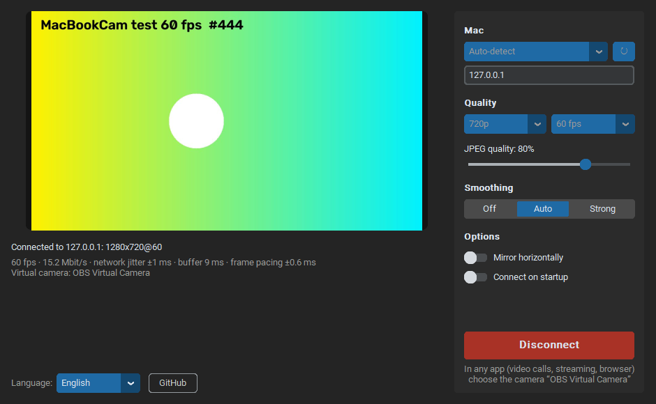

# MacBookCam

**Use your MacBook's camera as a webcam on a Windows PC, over your local Wi-Fi.**

[Русская версия](README.ru.md)



```
MacBook (menu bar app) ── Wi-Fi ──► PC (MacBookCam window) ──► "OBS Virtual Camera" ──► any app
```

The camera shows up on the PC as **OBS Virtual Camera**, so it works in any program that can pick a webcam: video calls, streaming software, messengers, the browser.

- **Free and open source** (MIT).
- **Up to 1080p and 60 fps**, if the camera supports it. Built-in MacBook cameras usually top out at 30 fps; an iPhone via Continuity Camera or a USB camera plugged into the Mac can do 60.
- **Smooth playback:** a jitter buffer evens out Wi-Fi hiccups, so every frame stays on screen for the same time.
- **Finds the Mac automatically**, even with a VPN on the PC. You can also enter the IP by hand.
- **Privacy:** the Mac's camera turns on only while the PC is connected. Video never leaves your local network.
- If the connection drops, the virtual camera keeps running with a placeholder and reconnects by itself.
- English and Russian interface (follows the system language, switchable).

## Download

Get the latest files from **[Releases](../../releases/latest)**:

| File | For |
|---|---|
| `MacBookCam-Windows.exe` | Windows 10/11 PC |
| `MacBookCam-Mac-AppleSilicon.dmg` | Mac with M1/M2/M3/M4 |
| `MacBookCam-Mac-Intel.dmg` | Mac with an Intel processor |

Not sure which Mac you have:  menu → About This Mac → "Chip" (Apple M…) or "Processor" (Intel).

## Setup

### Windows PC
1. Install [OBS Studio](https://obsproject.com/download). MacBookCam uses its virtual camera driver; you don't need to run OBS itself.
2. Run `MacBookCam-Windows.exe`. If SmartScreen warns about an unknown publisher: **More info → Run anyway**.

### Mac
1. Open the `.dmg` and drag **MacBookCam** into **Applications**.
2. The app isn't signed with an Apple Developer certificate, so macOS blocks it on first launch. Run once in Terminal:
   ```bash
   xattr -dr com.apple.quarantine /Applications/MacBookCam.app
   ```
   Or: System Settings → Privacy & Security → scroll down → "MacBookCam was blocked" → **Open Anyway**.
3. Launch it. A camera icon appears in the menu bar. Allow camera access when asked.

## Usage

1. **Mac:** start MacBookCam (menu bar icon; there's no window).
2. **PC:** start MacBookCam, keep "Auto-detect" (or pick your Mac / type its IP), press **Connect**.
3. **In your app:** choose the camera **OBS Virtual Camera**.

Keep the MacBook lid open (the camera is in it) and don't let the Mac go to sleep.

### Settings on the PC

| Setting | What it does |
|---|---|
| Resolution, fps | What to request from the Mac. If the camera can't do the requested fps, the window says so. |
| JPEG quality | Lower means less traffic and slightly less delay. |
| Smoothing | **Off**: lowest delay, frames shown as they arrive. **Auto**: a small buffer sized to the measured Wi-Fi jitter (recommended). **Strong**: the smoothest picture for unstable Wi-Fi, at the cost of extra delay. |
| Mirror | Flips the picture horizontally. |
| Connect on startup | Connects automatically when the app opens. |

The status line shows the real frame rate, bitrate, Wi-Fi jitter, buffer size and how evenly frames are delivered.

### Mac menu

Status and IP address (click to copy), pause streaming, choose the camera (built-in, iPhone, USB), disconnect the PC, launch at login, language.

## Troubleshooting

- **"Mac not found":** the router may block broadcast (guest networks, "client isolation"). Copy the IP from the Mac menu and enter it on the PC.
- **No connection even by IP:** make sure both devices are on the same network, and check the macOS firewall (System Settings → Network → Firewall). If macOS asks about local network access, allow it.
- **Camera error on the Mac:** Mac menu → "Open camera permission settings" → enable MacBookCam, then restart the app.
- **"No virtual camera" on the PC:** install OBS Studio. If OBS is running with its own virtual camera on, stop it.
- **Stutter or high jitter:** set Smoothing to Strong, lower the resolution or JPEG quality, move closer to the router, use 5 GHz Wi-Fi. On Macs, the AirDrop/Handoff radio (AWDL) is a known cause of periodic Wi-Fi delay spikes; `sudo ifconfig awdl0 down` turns it off until the next reboot (AirDrop and Handoff stop working meanwhile).

## How it works

The Mac captures the camera with AVFoundation (picking a camera format that supports the requested frame rate), encodes frames to JPEG and streams them over TCP with capture timestamps. The PC decodes them, schedules each frame by its timestamp plus a small adaptive buffer, and feeds the result into the OBS virtual camera via [pyvirtualcam](https://github.com/letmaik/pyvirtualcam). The Mac is discovered with a UDP broadcast on every network adapter.

Ports: TCP 5005 (video), UDP 5006 (discovery).

## Building from source

- **Windows:** `build_windows.bat` → `dist\MacBookCam.exe`
- **Mac:** `bash build_mac.sh` → `dist/MacBookCam.dmg`
- **CI:** GitHub Actions builds everything on each push to `main`; pushing a `v*` tag publishes a release.

Console versions without a GUI: `mac_sender.py` (Mac) and `pc_receiver.py` (PC); run them with `--help` for options. See [CONTRIBUTING.md](CONTRIBUTING.md) for the development setup.

## License

[MIT](LICENSE)
